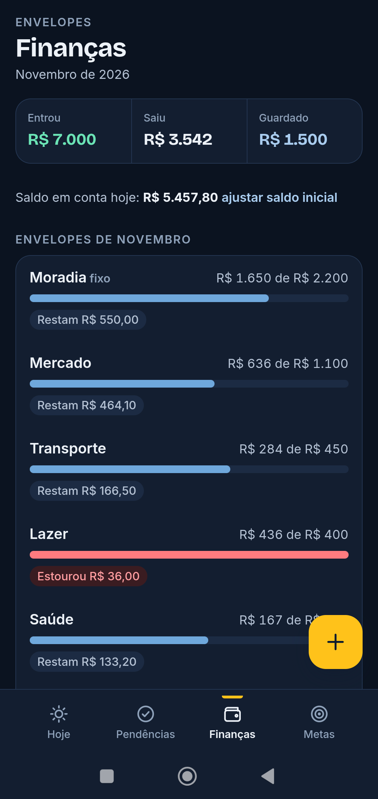
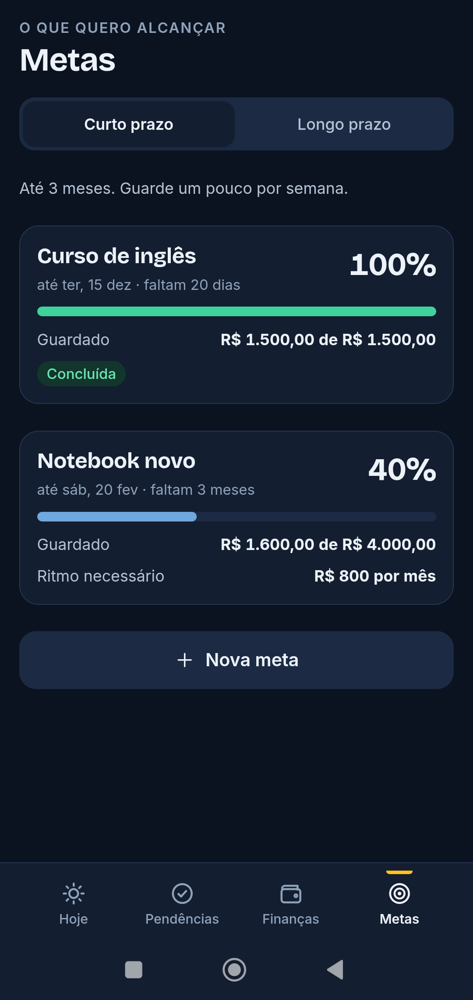
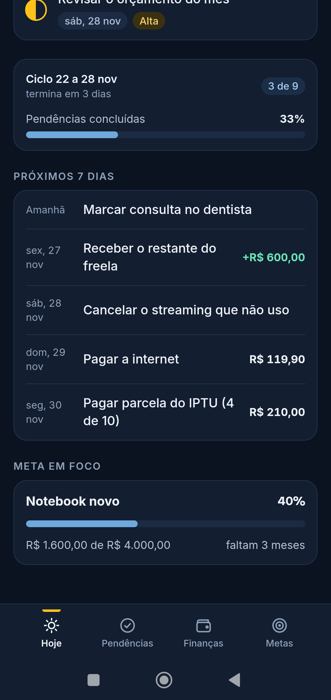

# Prumo

App mobile único de pendências e finanças pessoais, 100% local (React + Vite + Capacitor + SQLite).
Este arquivo é o **guia geral do projeto**: diz o que existe e onde fica. As instruções para a IA estão
no `CLAUDE.md`.

## Telas

Capturas do app no Android, com dados de exemplo.

<table>
  <tr>
    <td align="center"><br><sub><b>Hoje</b><br>quanto posso gastar e o que fazer</sub></td>
    <td align="center"><br><sub><b>Pendências</b><br>ciclo semanal e backlog</sub></td>
    <td align="center"><br><sub><b>Finanças</b><br>envelopes e lançamentos</sub></td>
  </tr>
  <tr>
    <td align="center"><br><sub><b>Metas</b><br>progresso e ritmo necessário</sub></td>
    <td align="center"><br><sub><b>Aporte</b><br>guardar dinheiro numa meta</sub></td>
    <td align="center"><br><sub><b>Hoje, mais abaixo</b><br>próximos 7 dias e meta em foco</sub></td>
  </tr>
</table>

## Mapa do projeto

| Onde | O que é |
|---|---|
| `src/` | o código; a árvore esperada está em `doc/standards/PADRAO-FRONTEND.md` §11.3 |
| `doc/adr/` | decisões de stack e estrutura (o `0001` é o ponto de partida) |
| `doc/standards/` | o padrão de desenvolvimento; o guia está em `doc/standards/README.md` |
| `doc/business-rules/` | regras de negócio, do dono do produto |
| `prumo.html` | protótipo visual das telas, só referência |
| `CLAUDE.md` | instruções para a IA |

## Como rodar e testar

Precisa de Node 24 e pnpm 10.

```bash
pnpm install
pnpm dev          # abre o app no navegador
pnpm check        # lint + tipos + testes
pnpm test:watch   # testes em modo contínuo
pnpm build        # gera dist/
```

### Android

Precisa do JDK 21 (`JAVA_HOME`) e do Android SDK (`ANDROID_HOME`, com a plataforma 36). O Capacitor 8
gera um projeto que exige Java 21; o JDK 17 não serve.

```bash
pnpm build && pnpm exec cap sync android   # copia dist/ para o projeto Android
cd android && ./gradlew assembleDebug      # gera o APK de teste
```
